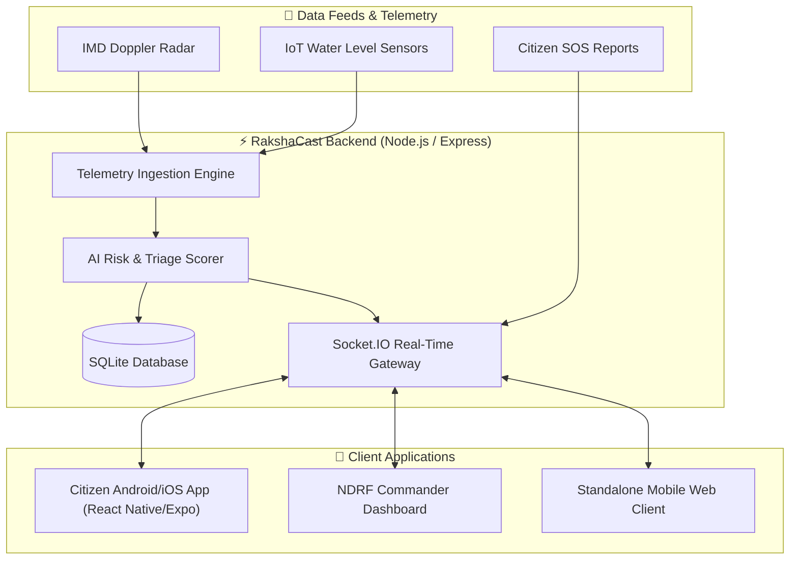

<div align="center">

# 🛰️ RakshaCast
### **AI-Powered Hyper-Local Disaster Early-Warning & Emergency Response Platform**

[](https://github.com/akshayamv-0909/RAKSHACAST)
[](https://www.imd.gov.in/)
[](LICENSE)
[](https://reactnative.dev/)
[](https://nodejs.org/)
[](https://socket.io/)
[](https://sqlite.org/)

<p align="center">
  <b>Official Repository:</b> <a href="https://github.com/akshayamv-0909/RAKSHACAST">https://github.com/akshayamv-0909/RAKSHACAST</a><br>
  <i>"Predict Early. Respond Faster. Recover Stronger."</i>
</p>

</div>

---

## 📌 Executive Summary

**RakshaCast** is an enterprise-grade, mobile-first disaster early-warning and rapid response ecosystem developed for **Smart India Hackathon 2026 (Problem Statement: SIH26077)** under the **Ministry of Earth Sciences (MoES)** and the **India Meteorological Department (IMD)**.

During extreme meteorological events (urban flooding, cloudbursts, cyclones, and landslides), every minute counts. RakshaCast bridges the gap between raw Doppler radar telemetry and ground-level action by:
1. **Citizens**: Equipping vulnerable communities with AI-driven hyper-local alerts, high-ground evacuation routing, and 1-tap SOS beacons.
2. **First Responders (NDRF / SDRF)**: Empowering emergency commanders with a real-time smart triage dashboard that ranks, maps, and coordinates rescue deployments based on AI threat severity.

```
+-----------+       +-------------------+       +-----------------------+       +-------------------+       +------------------+
|  PREDICT  | ----> |       WARN        | ----> |       EVACUATE        | ----> |      RESCUE       | ----> |     RECOVER      |
| Radar Data|       | Hyper-Local Alert |       | High-Ground Elevation |       | NDRF Smart Triage |       | Relief & Shelter |
+-----------+       +-------------------+       +-----------------------+       +-------------------+       +------------------+
```

---

## 🚀 Key Features

### 1. 🌦️ Real-Time Doppler Telemetry & Nowcasting
- Continuous ingestion of IMD Doppler radar data, precipitation rates, surface runoff surge levels, barometric pressure drops, and wind gust velocities.
- Dynamic **Risk Level Indicator** (Severe, High, Moderate, Safe) with accurate countdown timers for peak inundation.

### 2. 🗺️ Dynamic Elevation Evacuation Routing
- Computes real-time evacuation paths that route users through elevated ridges ($>410\text{m}$) while dynamically avoiding submerged underpasses, sinkholes, and low-lying choke points ($>1.5\text{m}$ water depth).
- Turn-by-turn navigation with offline hazard polygon caching.

### 3. 🚨 Instant 1-Touch SOS Beacon
- Generates high-priority distress signals with exact GPS coordinates, battery level, medical flags, and accessibility needs.
- Socket.IO fallback with SMS beacon simulation for low-connectivity zones.

### 4. 🚒 NDRF Tactical Command & Smart Triage Dashboard
- Real-time command center interface for NDRF/SDRF commanders.
- Automated AI triage scoring that prioritizes high-risk citizens (e.g., stranded infants, elderly, dialysis patients, rapidly submerging zones).
- One-click dispatch management for rescue boats, drones, and amphibious vehicles.

### 5. 🏥 Shelter Availability & Relief Logistics
- Live map markers for high-ground relief centers, medical camps, and food distribution hubs.
- Real-time shelter occupancy tracking with available bed counters.

---

## 🏗️ System Architecture



---

## 🛠️ Technology Stack

| Component | Technology | Purpose |
| :--- | :--- | :--- |
| **Mobile Frontend** | React Native, Expo, Metro Bundler | Cross-platform high-performance mobile application |
| **Styling & UI** | Custom Mobile Design System (High Contrast) | Emergency-optimized UI with large touch targets |
| **Backend API** | Node.js, Express.js | REST API routing and business logic |
| **Real-time Engine**| Socket.IO | Bi-directional, low-latency alert and SOS broadcasting |
| **Database** | SQLite3 / SQLite | Lightweight, portable persistence for incidents & shelters |
| **Build & Deploy** | EAS (Expo Application Services), Docker | Native Android APK compilation and containerization |

---

## 📂 Project Structure

```bash
RAKSHACAST/
├── App.js                     # React Native root component & navigation
├── app.json                   # Expo application configuration & permissions
├── babel.config.js            # Babel compiler presets
├── eas.json                   # Expo Application Services APK build profiles
├── index.js                   # Application entry point
├── metro.config.js            # Metro bundler configuration
├── package.json               # Dependencies and scripts
├── .env.example               # Environment variables template
│
├── assets/                    # App icons, splash screens, and emergency assets
├── docs/                      # Technical specifications, architecture docs & PRD
├── public/                    # Web assets & standalone mobile preview
│   └── standalone-mobile.html # Instant browser-based mobile simulator
│
└── server/                    # Backend microservice
    ├── index.js               # Express server & Socket.IO event handler
    ├── db.js                  # SQLite database connection & migrations
    └── routes/                # REST endpoints (telemetry, alerts, rescue)
```

---

## ⚡ Getting Started

### Prerequisites
- [Node.js](https://nodejs.org/) (v18.x or higher)
- [npm](https://www.npmjs.com/) or [yarn](https://yarnpkg.com/)
- [Expo Go App](https://expo.dev/go) (on your physical Android/iOS test device)

### 1. Clone the Repository
```bash
git clone https://github.com/akshayamv-0909/RAKSHACAST.git
cd RAKSHACAST
```

### 2. Environment Configuration
Create a `.env` file in the root directory (based on `.env.example`):
```env
PORT=8080
SOCKET_PORT=8080
NODE_ENV=development
IMD_API_KEY=your_mock_or_live_imd_api_key
MAPBOX_ACCESS_TOKEN=your_mapbox_token_here
```

### 3. Install Dependencies
```bash
npm install
```

### 4. Run the Backend & WebSocket Server
```bash
node server/index.js
```
*The server will start on `http://localhost:8080` with active Socket.IO listeners.*

### 5. Launch the Mobile Application (React Native / Expo)
In a new terminal window:
```bash
npx expo start
```
- Press `a` to open in an Android Emulator.
- Press `w` to open in a Web Browser.
- Scan the displayed QR code with the **Expo Go** app on your phone.

---

## 📱 Standalone Browser Mobile View
For instant evaluation without setting up an Android SDK or Expo environment:
1. Start the server: `node server/index.js`
2. Open your browser to `http://localhost:8080/public/standalone-mobile.html`
3. Toggle Device Toolbar in Chrome/Firefox DevTools (`Ctrl+Shift+M` or `Cmd+Shift+M`) and select **iPhone 14 / Pixel 7** ($390 \times 844\text{px}$).

---

## 📦 Building Native Android APK (EAS Build)

To produce a production-ready standalone `.apk` for field testing:

```bash
# 1. Install EAS CLI globally
npm install -g eas-cli

# 2. Log in to your Expo account
eas login

# 3. Configure the build
eas build:configure

# 4. Trigger the Android preview APK build
eas build -p android --profile preview
```

---

## 📡 API & WebSocket Reference

### REST Endpoints

| Method | Endpoint | Description |
| :--- | :--- | :--- |
| `GET` | `/api/telemetry/live` | Ingests real-time Doppler radar & rain gauge data |
| `GET` | `/api/shelters` | Retrieves list of high-ground shelters and available capacity |
| `POST` | `/api/sos` | Dispatches emergency citizen SOS packet to NDRF queue |
| `GET` | `/api/evacuation-routes` | Computes safe elevation corridors avoiding flooded grids |

### Socket.IO Events

| Event Name | Direction | Payload Description |
| :--- | :--- | :--- |
| `sos_broadcast` | Client $\rightarrow$ Server | Citizen distress signal with GPS, medical flags, and battery status |
| `alert_nowcast` | Server $\rightarrow$ Client | Hyper-local flash flood warning broadcast to affected geo-fence |
| `ndrf_dispatch_update` | Server $\rightarrow$ Client | Real-time rescue boat status update sent to stranded citizens |

---

## 🤝 Contributing

Contributions are welcome! If you would like to contribute:
1. Fork the Project (`https://github.com/akshayamv-0909/RAKSHACAST/fork`)
2. Create your Feature Branch (`git checkout -b feature/AmazingFeature`)
3. Commit your Changes (`git commit -m 'Add some AmazingFeature'`)
4. Push to the Branch (`git push origin feature/AmazingFeature`)
5. Open a Pull Request

---

## 📄 License

Distributed under the **MIT License**. See [`LICENSE`](LICENSE) for more information.

---

<div align="center">
  <sub>Developed with ❤️ by the <b>RakshaCast Team</b> for Smart India Hackathon 2026.</sub><br>
  <sub>Maintained by <a href="https://github.com/akshayamv-0909">@akshayamv-0909</a></sub>
</div>
